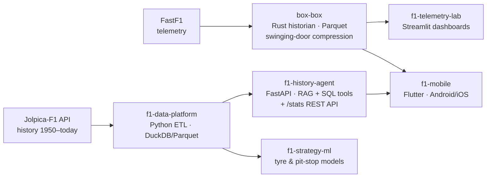

# F1 Data Platform — an applied-engineering portfolio

An end-to-end data & AI platform built around Formula 1 public data, designed as a set of
integrated cases that demonstrate applied knowledge across **data engineering, industrial
time-series systems, applied AI/RAG, dashboards, machine learning and mobile**.

> 🏗️ **Status: scaffolded.** Architecture and scope are defined (see below) and every case has
> its skeleton, CI and Docker image in this monorepo; implementation is happening case by case.
>
> 📄 Full solution overview (architecture, infrastructure, BPM process diagrams, glossary):
> **https://deepcode.com.br/f1/**

## Why F1?

Formula 1 generates rich public data (70+ years of history, modern telemetry) and its
engineering culture mirrors industrial operations: telemetry historians, real-time dashboards,
strategy models. This platform intentionally reuses patterns from regulated industrial
environments — where its author works daily (AVEVA PI System, GxP) — and rebuilds them
from scratch in the open.

## The platform



| # | Case | Focus | Stack | Status |
|---|------|-------|-------|--------|
| 1 | [`f1-data-platform`](f1-data-platform/) | Data engineering: layered ETL of full F1 history | Python, DuckDB, Parquet | 🧱 scaffold |
| 2 | [`box-box`](box-box/) | A minimal industrial historian (PIMS) for telemetry: tag/time-series model, swinging-door compression, query API | Rust, Arrow/Parquet, axum | 🧱 scaffold |
| 3 | [`f1-telemetry-lab`](f1-telemetry-lab/) | PI-Vision-style comparative telemetry dashboards | Python, Streamlit, FastF1 | 🧱 scaffold |
| 4 | [`f1-history-agent`](f1-history-agent/) | Headless AI agent: RAG over F1 history + SQL tool-calling for exact stats, with automated evals | Python, FastAPI, local embeddings | 🧱 scaffold |
| 5 | [`f1-strategy-ml`](f1-strategy-ml/) | Tyre degradation & pit-window models | Python, scikit-learn | 📋 phase 2 |
| 6 | [`f1-mobile`](f1-mobile/) | Mobile client for the platform APIs: natural-language Q&A, stats explorer, telemetry charts, offline-first | Flutter/Dart | 📋 phase 2 |

## Run the platform

```bash
docker compose up                      # box-box :8081 · history-agent :8080 · telemetry-lab :8501
docker compose --profile etl run etl   # one-shot history ETL (writes the shared DuckDB volume)
```

Each case folder has its own README with local-development instructions (`uv` for Python, `cargo` for Rust).

## Design principles

- **Integration over isolation** — every case consumes or feeds another; the platform tells one architecture story.
- **Exact numbers, never hallucinated** — the AI agent answers stats via SQL tool-calling; RAG is reserved for narrative.
- **Industrial patterns in the open** — the PIMS case implements the historian concepts (tags, compression deviation, downsampling) that usually live behind enterprise licenses.
- **Evaluation as a feature** — the agent ships with a golden Q&A eval set and automated scoring.
- **Docker-first** — every runnable case ships a `Dockerfile` and `docker-compose.yml`; `docker compose up` is the only requirement to bring it up. Local toolchains (uv, cargo) are optional, for development only.

## Author

**Rodrigo Manso** — AI Solutions Architect, founder of [DeepCode Inteligência de Dados](https://deepcode.com.br).
25 years building mission-critical systems for healthcare, government and the pharmaceutical
industry (GxP-regulated environments, AVEVA PI System). [LinkedIn](https://www.linkedin.com/in/rodrigolmanso/)

## Data sources & attribution

[Jolpica-F1](https://github.com/jolpica/jolpica-f1) (Ergast successor) · [FastF1](https://github.com/theOehrly/Fast-F1) (MIT) · Wikipedia (CC BY-SA).
This is an unofficial project and is not associated in any way with Formula 1 companies. F1 and related marks are trademarks of Formula One Licensing B.V.

## License

MIT
