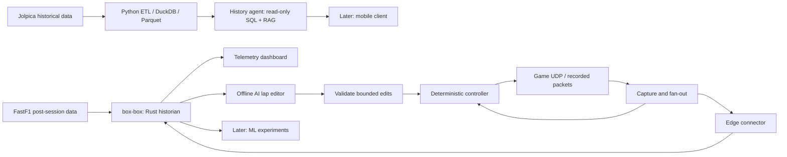

# F1 Data Platform — telemetry and AI experiments

A personal engineering lab by **Rodrigo Manso**, supported by [DeepCode](https://deepcode.com.br). Eight connected cases explore historical data, game telemetry, industrial historian patterns and controlled AI experiments.

**Status — 13 October 2026:** ETL implementation and isolated Python prototypes are in progress. The live telemetry pipeline, AI-controlled lap experiments and motion rig are not yet demonstrated. Status describes the local code reviewed on this date; consult each component for newer execution evidence.

- [Design and scope](FOUNDATIONS.md)
- [Validation gates and evidence protocol](docs/VALIDATION.md)
- [Public overview — English](https://deepcode.com.br/en/f1/) · [Português](https://deepcode.com.br/f1/)

- [Role-aligned stack plan](docs/STACK-ALIGNMENT.md): Rust historian, planned C++ execution runtime, Python data/AI and a future React/TypeScript interface.

## Target architecture



This diagram is a target design, not a depiction of a working integrated deployment. A controller receives telemetry independently of historian availability; the LLM proposes changes between laps. Motion-cue research is optional and outside the first release.

## Implementation map

| Component | Present code / scope | Still to demonstrate |
|---|---|---|
| [f1-data-platform](f1-data-platform/) | Historical ETL implementation; raw/staging/marts and quality modules | See the actively maintained component README for run evidence and remaining backfill |
| [box-box](box-box/) | Rust historian v1: HTTP ingest, swinging-door compression, WAL + Parquet, restart recovery, query/downsampling/interpolation, metrics; [evidence](docs/evidence/2026-10-13-box-box-v1.md) from a synthetic local run | Real packets through the connector, FastF1 batch import, retention, multi-client load |
| [f1-sim-connector](f1-sim-connector/) | Header parser, tags, exception filter, in-memory buffer | Packet bodies, live listener, durable delivery and historian client |
| [f1-telemetry-lab](f1-telemetry-lab/) | Streamlit scaffold | Dashboard consuming the historian API |
| [f1-history-agent](f1-history-agent/) | FastAPI health scaffold | SQL tools, RAG, API contracts and evaluations |
| [f1-sim-driver](f1-sim-driver/) | Lap-script schema, interpolation, position-hold and edit prototypes | State capture, game-input adapters, stable closed loop and AI experiments |
| [f1-strategy-ml](f1-strategy-ml/) | Scaffold / later phase | Models, chronological evaluation and domain-shift analysis |
| [f1-mobile](f1-mobile/) | Scaffold / later phase | Client against stable platform APIs |

## Run what exists

From the repository root, Docker and Compose are required for container commands:

```bash
docker compose up box-box history-agent telemetry-lab
```

This starts the historian (functional v1), the history-agent health scaffold and the dashboard shell, not a complete telemetry platform. Connector and driver container defaults currently display CLI help; they do not capture UDP or drive the game. Follow each component README for local commands and the ETL README for current pipeline execution. Compose port declarations alone do not implement packet fan-out.

## First deliverable

One recorded session → versioned decoding → connector → historian → dashboard, with raw data preserved and replay reproducible. Then prove outage/restart recovery and quantify compression error. Validate the game-input adapter early, but only begin AI lap editing after a repeatable non-LLM baseline exists.

## Engineering principles

- Evidence before claims: publish commands, environment, source provenance and failures with every result.
- The LLM edits between laps; deterministic code handles the control loop.
- Statistics come from validated, bounded read-only queries; tool use does not itself guarantee correct answers.
- Separate prototype behavior from intended durability, throughput and control guarantees.
- Use the same observations, tools and trial budgets when comparing model-assisted approaches.

## Build journal

Planned series: **Building a Telemetry Lab / Construindo um Laboratório de Telemetria**, by Rodrigo Manso with DeepCode support. Separate English and Portuguese videos follow the milestones: capture, replay, recovery, signal fidelity, baseline control and AI evaluation. Channel links will be added after setup; no publication schedule is a promise of feature completion.

## Attribution and license

Repository source code is MIT licensed. That does not relicense datasets or game assets. [Jolpica data terms](https://github.com/jolpica/jolpica-f1/blob/main/TERMS.md) specify CC BY-NC-SA 4.0. FastF1's MIT license covers its software, not blanket rights to underlying telemetry. Record provenance and permitted use for each dataset, document corpus and published clip; check applicable terms before redistribution or monetisation. Wikipedia content needs its applicable attribution and license retained.

Game telemetry is intended to come from the author's own sessions. This unofficial project is not affiliated with Formula 1, its teams or EA.

## Author

Rodrigo Manso — Senior Software Engineer / Software Architect, 25 years across public administration, healthcare and life sciences. [LinkedIn](https://www.linkedin.com/in/rodrigolmanso/) · [DeepCode](https://deepcode.com.br)
